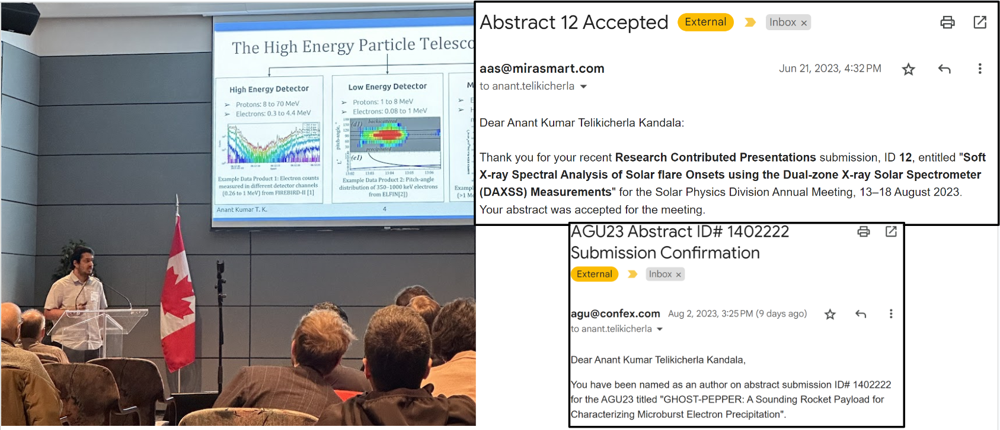

I have listed down by SMART goals below. I have mentioned the Skills domain(s) that align with each goal. I have categorized them as Academic or Personal, and also divided each goal into the five SMART aspects:

## Academic Goal 1 (Skills Domain(s) - Research and Project Management, Critical and creative thinking ):

* **Specific:** I would like to become proficient in the art of reading journal publications. 
* **Measurable:** I will know I'm successful if I can read through a paper fairly quickly, while understanding the key points - objectives, analysis and conclusions. 
* **Achievable:** My plan to accomplish this goal is to try to read a paper every week. I will start by reading some papers I already have related to my area of research. 
* **Relevant:** Developing this skill is very important to becoming a good researcher. As Isaac Newton succinctly described the importance of understanding previous research: “If I have seen further, it is by standing on the shoulders of Giants”.
* **Timebound:** I would like to develop this skill by the end of Masters (2 years). I will start by reading a paper per week. 

> Reflection on Academic Goal-1: I read 15-20 journal articles during the duration of this course. I can now read through a paper fairly quickly, while understanding the key
points - objectives, analysis and conclusions.

## Academic 2 (also Personal) (Skills Domain(s) - Interpersonal Skills, Career Development, Communication):

* **Specific:** I would like to become more confident in various aspects of my life: in my research and in my personal life. Specifically, during research presentations, lab meetings, as well as interactions with friends and colleagues. 
* **Measurable:** I have been given feedback multiple times before that I come across as "too humble", during research interactions/presentations. Although, I believe humility is a integral principle I abide by, I would like to come across as confident while making presentations and in discussions. 
* **Achievable:** I will achieve this by trying to proactively think about this during my presentations and research group discussions. 
* **Relevant:** This is important to having a successful career as a researcher, as a major part of research is to share my research with the broader community.
* **Timebound:** I would like to develop this skill by the end of Masters (2 years), and will try to make improvements, through my weekly lab group meetings, and conferences that I attend. 

> Reflection on Academic Goal-2: I am trying to achieve this by proactively thinking about this during my presentations and research group discussions. During this course, I have presented work at conferences (DASP at the Canadian Space Agency) and also attended a summer school (GRIDS at TRIUMF, UBC).

### Learning Activity and Artifact for Academic Goals 1 & 2
For working towards my Academic Goals, I took proactive steps to present my research as well as submit conference abstracts/journal articles. During the duration of this course, I have presented at two conferences, submitted 3 abstracts, and also co-authored
a journal publication. Below are my aritfacts, a picture of me presenting at the DASP conference, as well as my abstract notification email for SPD54 and AGU23.

## Personal 1 (Skills Domain(s) - Intrapersonal Skills, Wellness and life balance, Intercultural competence):

* **Specific:** I would like to step out of my comfort zone by trying new hobbies and meeting different people during my Master's. 
* **Measurable:** I would like to atleast do one new activity per month, that is outside my comfort zone, and exposes me to new interesting people/places.
* **Achievable:** I plan to achieve this goal by meeting new people by participating in various events at the university including various clubs, meetups etc. Also, by  by participating in Open Stage events through which I can also improve my music (guitar) performance skills. 
* **Relevant:** I would need to make time and plan activities to participate in. Even with a lot of course load, I believe this will be possible. 
* **Timebound:** As mentioned I would like to do an activity once a month, during the two years of my Master's.

> Reflection on Personal Goal-1: I have visited four different Canadian provinces so far in my Masters, aming to visit the rest before my graduation!. I also tried
performing at an Open Mic music event in Edmonton. 

## Personal 2 (Skills Domain(s) - Wellness and life balance): 
* **Specific:**  I would like to make exercise a regular part of my schedule. 
* **Measurable:** I would like to do some form of exercise at least 5 days a week, for atleast an hour per day.  
* **Achievable:** My strategy to do this is by making a schedule for each day. I believe trying different sports would be motivating, as compared to going to the gym everyday. So, I would like to go to play Badminton, Squash, and football (soccer) one day per week, and go to the gym for the remaining days. 
* **Relevant:** This will help improve my physical health, as well as mental health, by creating a work-life balance in my day-to-day schedule. 
* **Timebound:** I believe exercise should be a habit/part of my life. I can start by finding friends and scheduling the sports once a week.  

> Reflection on Personal Goal-2: I have learned squash and pickleball during this year, and play regularly on campus. I have been playing football (/soccer) regularly.